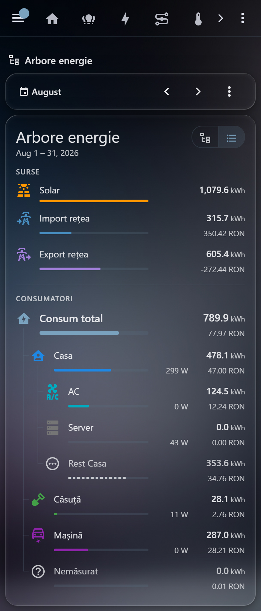
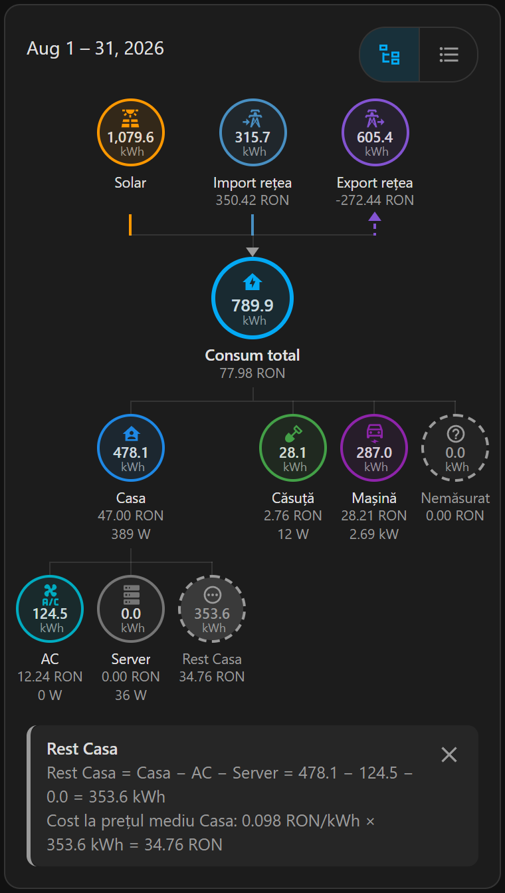
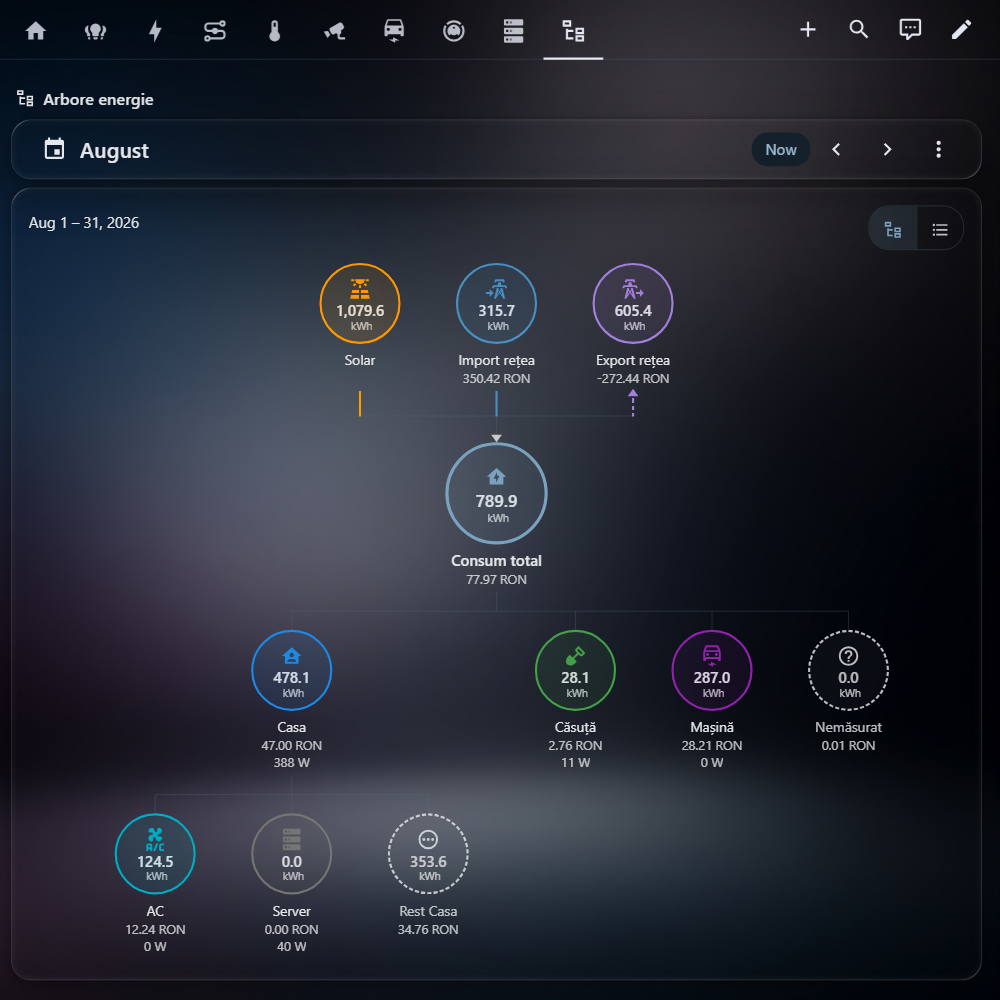

# Energy Tree Card

[](https://github.com/hacs/integration)

A Home Assistant dashboard card that shows household energy as a hierarchy for
the period selected in the Energy date picker. Sources sit on top (solar, grid
import, grid export), Home in the middle (total consumption), and consumers form
a tree under Home: a consumer can have its own consumers, and each child line
starts from its parent. Every node shows the energy (kWh) and the cost for the
period, read from long-term statistics, and optionally the live power.

The card exists because `energy-flow-card-plus` and `power-flow-card-plus`
cannot nest devices (individual devices always hang off Home, at most four),
do not follow the selected period for their secondary values and have no cost
per device.

## Screenshots







## Features

- Consumers nested to any depth (`parent`), any number of them.
- Follows the Energy date picker: day, week, month, year or a custom range.
- Per node: kWh and cost for the period, optional live power, icon and colour.
- Automatic nodes: *Rest* under every consumer that has children (parent minus
  its children) and *Untracked* under Home (Home minus the first-level consumers).
- Home computed from the sources: solar + grid import − grid export.
- Costs from the statistics of cost sensors, including Home Assistant's own
  energy cost and compensation sensors. Grid export compensation is shown as a credit.
- Two layouts: circles and lines (tree), or indented horizontal bars. `auto`
  picks bars on narrow cards; a toggle in the header switches between them and
  the choice is remembered on the device.
- The tree shrinks to fit a phone (six leaf columns fit a 360 px screen).
- Tap a node: measured nodes open the more-info dialog, computed nodes (Home,
  Rest, Untracked) explain their value with the period's numbers.
  `tap_action` changes this per node.
- Romanian and English built-in labels; colours from the Home Assistant theme.

## Installation

### HACS

1. In Home Assistant open **HACS** → ⋮ (top right) → **Custom repositories**.
2. Add `https://github.com/ZaBug/energy-tree-card` with type **Dashboard**.
3. Search for **Energy Tree Card** in HACS, open it and press **Download**.
4. Reload the browser page.

HACS registers the dashboard resource itself. If your resources are managed in
YAML, add `/hacsfiles/energy-tree-card/energy-tree-card.js` with type `module`.

### Manual

1. Download `energy-tree-card.js` from the latest
   [release](https://github.com/ZaBug/energy-tree-card/releases) (or build it,
   see [Development](#development): `dist/energy-tree-card.js`).
2. Copy it to `/config/www/energy-tree-card.js`.
3. Settings → Dashboards → ⋮ → **Resources** → **Add resource**: URL
   `/local/energy-tree-card.js`, type **JavaScript module**. (The Resources
   menu needs *Advanced mode* in your user profile.)
4. Reload the browser page.

## Usage

The card has no visual editor yet: add a **Manual** card and paste the YAML.

### Energy date picker

The card shows the period selected in the Energy date picker, so the dashboard
needs an `energy-date-selection` card. Without one the card shows today and a
short note ("No Energy date picker: showing today").

The picker can be on any view of the same dashboard, but the card only finds it
once that view has been shown; putting both cards on the same view is simplest.
If the picker uses a `collection_key`, set the same `collection_key` on this
card (it must start with `energy_`).

A sections view with both cards:

```yaml
views:
  - title: Energy
    type: sections
    sections:
      - type: grid
        cards:
          - type: energy-date-selection
          - type: custom:energy-tree-card
            sources:
              grid_import:
                energy: sensor.grid_import_energy
            nodes:
              - id: heat_pump
                name: Heat pump
                energy: sensor.heat_pump_energy
```

### Minimal example

One source and two consumers:

```yaml
type: custom:energy-tree-card
title: Energy
sources:
  grid_import:
    energy: sensor.grid_import_energy
nodes:
  - id: heat_pump
    name: Heat pump
    energy: sensor.heat_pump_energy
  - id: ev_charger
    name: EV charger
    energy: sensor.ev_charger_energy
```

With only grid import, Home equals the imported energy. Under Home the card
shows Heat pump, EV charger and an automatic *Untracked* node with what the two
do not cover.

## Configuration reference

Entities given as `energy` or `cost` are read from long-term statistics, so they
must be sensors that have them (`state_class: total` or `total_increasing`).
Energy values are converted to kWh, so sensors in Wh or MWh work too. A `power`
entity is shown as its current state.

An invalid config (a missing required option, a duplicate or reserved `id`, an
unknown `parent`, a parent cycle) is shown as an error card with the reason.

### Card options

| Option | Default | Description |
|---|---|---|
| `type` | required | `custom:energy-tree-card` |
| `title` | none | Card title |
| `collection_key` | the dashboard's date picker | Energy collection to follow; the `collection_key` of the date picker. Must start with `energy_` |
| `layout` | `auto` | `auto`, `tree` or `bars`. `auto` shows bars when the card is narrower than `narrow_width`, otherwise the tree |
| `narrow_width` | `600` | Card width in px below which `layout: auto` shows bars |
| `language` | Home Assistant user language | `ro` or `en`, for the built-in labels. Romanian when the user language is Romanian, otherwise English |
| `currency` | Home Assistant currency | Currency shown with costs |
| `kwh_decimals` | `1` | Decimals for kWh values |
| `cost_decimals` | `2` | Decimals for costs |
| `sources` | none | `solar`, `grid_import`, `grid_export`, each optional; see [Sources](#sources) |
| `home` | built-in | Home node options; see [Home](#home) |
| `nodes` | none | List of consumers; see [Nodes](#nodes) |
| `rest` | shown | Automatic Rest nodes; see [Rest and untracked](#rest-and-untracked) |
| `untracked` | shown | Automatic Untracked node; see [Rest and untracked](#rest-and-untracked) |

### Sources

`sources.solar`, `sources.grid_import` and `sources.grid_export` take the same
options. A source that is not configured counts as 0.

| Option | Default | Description |
|---|---|---|
| `energy` | required | Cumulative energy sensor: solar production, energy imported from or exported to the grid |
| `cost` | none | Cost sensor. For `grid_import` the energy cost sensor (for example the `*_cost` sensor the Energy dashboard creates when a price is set); for `grid_export` the compensation sensor (`*_compensation`), shown as a negative amount |
| `power` | none | Live power sensor |
| `name` | see [Defaults](#defaults) | Display name |
| `icon` | see [Defaults](#defaults) | Icon |
| `color` | see [Defaults](#defaults) | Any CSS colour |
| `tap_action` | more-info | What a tap does; see [Tap](#tap) |

### Home

| Option | Default | Description |
|---|---|---|
| `name` | see [Defaults](#defaults) | Display name |
| `icon` | see [Defaults](#defaults) | Icon |
| `color` | see [Defaults](#defaults) | Any CSS colour |
| `power` | none | Live power sensor for the whole house |
| `tap_action` | explain | What a tap does; see [Tap](#tap) |

### Nodes

Each entry of `nodes` is one consumer.

| Option | Default | Description |
|---|---|---|
| `id` | required | Unique id, used by `parent` |
| `name` | required | Display name |
| `energy` | required | Cumulative energy sensor of the consumer |
| `cost` | none | Cost sensor of the consumer |
| `power` | none | Live power sensor |
| `parent` | first level | `id` of another node. Omitted or `home`: directly under Home |
| `icon` | `mdi:flash` | Icon |
| `color` | see [Defaults](#defaults) | Any CSS colour |
| `tap_action` | more-info | What a tap does; see [Tap](#tap) |

Reserved ids: `home`, `solar`, `grid_import`, `grid_export`, `untracked` and any
id starting with `rest:`.

### Rest and untracked

`rest` applies to all automatic Rest nodes, `untracked` to the automatic
Untracked node under Home.

| Option | Default | Description |
|---|---|---|
| `show` | `true` | `false` hides the node(s) |
| `name` | see [Defaults](#defaults) | Display name. In `rest.name`, `{parent}` is replaced by the parent's name |
| `icon` | see [Defaults](#defaults) | Icon |
| `color` | see [Defaults](#defaults) | Any CSS colour |
| `tap_action` | explain | What a tap does; see [Tap](#tap) |

### Tap

Every node is a button: tap or click it, or focus it with the keyboard and
press Enter or Space.

Without `tap_action`:

| Node | Tap |
|---|---|
| Source or consumer with a value | Opens the more-info dialog of its `power` sensor, else of its `energy` sensor |
| Home, Rest, Untracked | Shows how the value is computed (see below) |
| Any node showing "—" for its energy | Shows why the value is missing |

`tap_action` takes the standard Home Assistant action object, the same as in
the built-in cards: `more-info`, `navigate`, `url`, `perform-action`, `none`,
with their options (`entity`, `navigation_path`, `url_path`, `perform_action`,
`data`, `target`, `confirmation`, ...). The card only checks that it is an object
with an `action`; Home Assistant runs it. Two details:

- `more-info` without `entity` uses the node's `power` sensor, else its `energy`
  sensor.
- `explain` is an extra action of this card: show the explanation, on any node
  (on a measured node it names the statistics behind its values).

A node with `action: none` is not a button. `rest.tap_action` applies to all
Rest nodes.

Mașină opens a dashboard view with the car's costs, Home opens more-info of the
house power sensor:

```yaml
home:
  power: sensor.house_power
  tap_action:
    action: more-info
nodes:
  - id: masina
    name: Mașină
    energy: sensor.wallbox_energie_totala
    tap_action:
      action: navigate
      navigation_path: /lovelace/cost-masina
```

The explanation uses the numbers of the selected period, formatted like the
card. For Home it shows the source formula and the cost:

```
Consum total = Solar + Import rețea − Export rețea = 1.079,6 + 315,7 − 605,4 = 789,9 kWh
Cost = Import rețea − Export rețea = 350,42 − 272,44 = 77,98 RON
```

For Rest and Untracked it shows the subtraction, a note when the measured
consumers add up to more than their parent (the node then shows 0), and the cost
at the parent's average price:

```
Rest Casa = Casa − AC − Server = 478,1 − 124,5 − 0,0 = 353,6 kWh
Cost la prețul mediu Casa: 0,098 RON/kWh × 353,6 kWh = 34,76 RON
```

A missing value names the sensor ("sensor.x does not exist and has no
statistics"), and a live power sensor without a value adds "sensor.x:
unavailable". In bars the explanation opens under the row, in the tree in a
strip under the tree with a close button. One explanation is open at a time;
tapping the node again closes it. It follows the period and closes when its
node is gone.

### Defaults

Default names depend on `language`; names set in the config are always used as
written.

| Node | Name (`en`) | Name (`ro`) | Icon | Colour |
|---|---|---|---|---|
| Solar | Solar | Solar | `mdi:solar-power-variant` | `--energy-solar-color` |
| Grid import | Grid import | Import rețea | `mdi:transmission-tower-import` | `--energy-grid-consumption-color` |
| Grid export | Grid export | Export rețea | `mdi:transmission-tower-export` | `--energy-grid-return-color` |
| Home | Home | Consum total | `mdi:home-lightning-bolt` | theme |
| Consumer | (required) | (required) | `mdi:flash` | theme |
| Rest | Other {parent} | Rest {parent} | `mdi:dots-horizontal-circle-outline` | theme |
| Untracked | Untracked | Nemăsurat | `mdi:help-circle-outline` | theme |

## How values are computed

### Period

The card follows the Energy date picker of the dashboard (see
[Energy date picker](#energy-date-picker)). It refreshes when the selection
changes and when the energy collection refreshes, which happens hourly. Without
a picker it shows today, from local midnight.

### Statistics

Values come from `recorder/statistics_during_period` with `types: ["change"]`
and `units: {energy: "kWh"}`. The value of a node is the sum of `change` over
the selected range. Entity states are never summed.

The statistics period is chosen like the Home Assistant Energy dashboard does:

| Selected range | Statistics period | Typical picker selection |
|---|---|---|
| Up to 2 full days | `hour` | Day |
| Longer than 2 days | `day` | Week, month |
| Whole months, longer than 35 days (starts on the 1st, ends on the last day of a month) | `month` | Year |

Long-term statistics are compiled hourly, so the hour in progress is not
included yet (the Energy dashboard behaves the same).

Because the value is the sum of `change`, cost sensors with `state_class: total`
that reset every month through `last_reset` work as well as `total_increasing`
sensors.

### Derived nodes

| Node | Energy | Cost |
|---|---|---|
| Home | solar + grid import − grid export, never below 0 | grid import cost − grid export compensation; only when grid import has `cost` and grid export has `cost` or is not configured |
| Rest (for each node with children) | parent − sum of its children, never below 0 | Rest energy × the parent's average price (parent cost / parent energy), when the parent has a cost |
| Untracked (last child of Home) | Home − sum of the first-level consumers, never below 0 | Untracked energy × Home's average price (Home cost / Home energy), when Home has a cost |

Rest is added as the last child of its parent. A `cost` on the solar source is
shown on the solar node only; it is not part of the Home cost.

Rest and Untracked costs follow their energy, not the siblings' costs: when a
consumer's cost statistics miss part of the range, the gap stays visible on
that consumer (its cost looks too low for its kWh) instead of turning up as
money on Untracked. As a consequence the children's costs only add up to the
parent's cost when every consumer pays the same average price.

### Costs

- A node's cost is the sum of `change` of its `cost` sensor over the range.
- Grid import `cost` is Home Assistant's energy cost sensor; grid export `cost`
  is the compensation sensor and is shown as a negative amount (a credit).
- Nodes without `cost` (and derived nodes whose cost cannot be computed) show
  kWh only.
- Costs can be negative, for example a consumer's share of a net bill in a month
  with more export than import.

### Missing data

- An entity that does not exist and has no statistics for the range shows "—".
  The card never shows NaN.
- An entity that exists but has no statistics in the range counts as 0.
- If a child is unavailable, Rest (or Untracked, for Home) of that parent shows "—".

### Layout, language and theme

- `layout: auto` (default) shows bars when the card is narrower than
  `narrow_width` (600 px by default), otherwise the tree. The toggle in the
  header switches the layout without changing the config. The choice is
  remembered in the browser's local storage, per device and per dashboard view
  (cards on the same view share it), and overrides `layout` on the next visit.
  Changing `layout` or `narrow_width` in the config clears it.
- Bars: source bars compare the sources with each other; Home's bar is full
  and every consumer bar shows its share of the parent.
- Tree: when the tree does not fit the card at its normal size, it gets
  compact: the column width becomes the card width divided by the number of
  leaf columns (at least 54 px), circles and fonts get smaller, and costs may
  wrap onto two lines. Six leaf columns fit a 334 px card (a 360 px phone).
  Only a tree that does not fit even then scrolls sideways; it opens centred on
  Home and fades the edges that hide nodes. Cards of 900 px or more spread the
  nodes a little.
- `language` sets the built-in labels (default node names, layout toggle,
  notes). The default follows the Home Assistant user language and falls back
  to English. Node names from the config always win.
- Colours come from the Home Assistant theme (`--energy-solar-color`,
  `--energy-grid-consumption-color`, `--energy-grid-return-color`,
  `--primary-color`, ...). `color` on a node accepts any CSS colour.

## Full example

The author's setup, with Romanian labels:

```yaml
type: custom:energy-tree-card
title: Arbore energie
language: ro
sources:
  solar:
    energy: sensor.shellyem3_485519db8f59_channel_a_energy_returned
    name: Solar
  grid_import:
    energy: sensor.principal_energy
    cost: sensor.principal_energy_cost
    name: Import rețea
  grid_export:
    energy: sensor.principal_energy_returned
    cost: sensor.principal_energy_returned_compensation
    name: Export rețea
home:
  name: Consum total
nodes:
  - id: casa
    name: Casa
    energy: sensor.casa_energy
    cost: sensor.cost_lunar_casa
    power: sensor.casa_power
    icon: mdi:home-account
    color: "#1e88e5"
  - id: ac
    parent: casa
    name: AC
    energy: sensor.18691697773822_total_energy_consumption
    cost: sensor.cost_lunar_ac
    power: sensor.18691697773822_realtime_power
    icon: mdi:air-conditioner
    color: "#00acc1"
  - id: server
    parent: casa
    name: Server
    energy: sensor.ups_energy_spent
    cost: sensor.cost_server_lunar
    power: sensor.ups_power_sensor
    icon: mdi:server
    color: "#757575"
  - id: casuta
    name: Căsuță
    energy: sensor.casuta_energy
    cost: sensor.cost_lunar_casuta
    power: sensor.casuta_power
    icon: mdi:shovel
    color: "#43a047"
  - id: masina
    name: Mașină
    energy: sensor.wallbox_energie_totala
    cost: sensor.ev_cost_factura_neta
    power: sensor.duosida_mode3_32a_power
    icon: mdi:car-electric-outline
    color: "#8e24aa"
```

Casa has two children, AC and Server, so the card adds *Rest Casa* (Casa minus
AC and Server). Under Home (*Consum total* = Solar + Import rețea − Export
rețea) the card adds *Nemăsurat*, the consumption not covered by Casa, Căsuță
and Mașină. Casa and Home have a cost, so Rest Casa and Nemăsurat get one too.

```
Solar   Import rețea   Export rețea
Consum total
├── Casa
│   ├── AC
│   ├── Server
│   └── Rest Casa      (automatic)
├── Căsuță
├── Mașină
└── Nemăsurat          (automatic)
```

## Limitations and roadmap

Limitations:

- The browser time zone must be the same as the Home Assistant time zone. Day
  and month statistics are bucketed in the Home Assistant time zone; with a
  different browser time zone the range does not line up with the buckets and
  week, month or year values are off.
- The hour in progress is not included (long-term statistics are hourly).
- Values come only from long-term statistics: a sensor without them shows 0 or "—".
- The period needs an Energy date picker on the dashboard; without one the card
  shows today.

Not in this version:

- Visual editor (configuration is YAML only)
- Animations
- Battery, gas and water
- Comparison with a previous period

## Development

```bash
npm ci
npm test            # Vitest
npm run build       # type check + Vite build
```

The build writes a single file, `dist/energy-tree-card.js`. To try it, copy it
to `/config/www/` as in the [manual installation](#manual).

`npm run dev` serves a local harness at `/dev/index.html` with the author's
data and a dark theme. Query parameters: `widths=360,400,1200` (card frames),
`layout`, `period` (`azi`, `luna`, `aug`, `an`), `locale` and `picker=0`. Taps
that Home Assistant would handle are logged under the controls.

Releases: set the new version in `package.json` (the card reads its version
from there), add it to `CHANGELOG.md`, commit, then push a tag `vX.Y.Z` with
the same version. The release workflow tests and builds, checks that the
tag matches `package.json`, and creates the GitHub release with
`energy-tree-card.js` attached; HACS installs that asset.

## License

[MIT](LICENSE)
